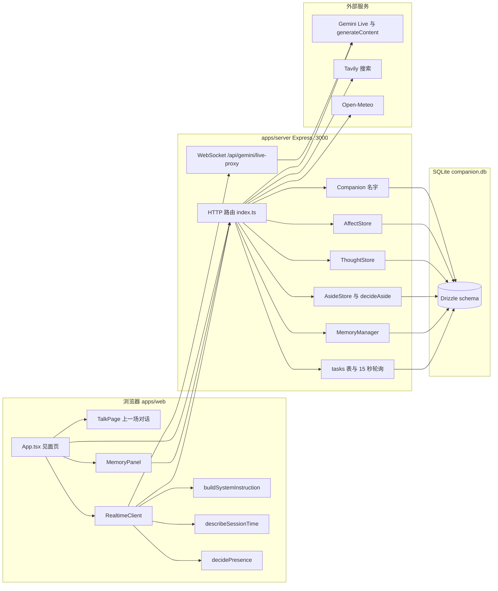
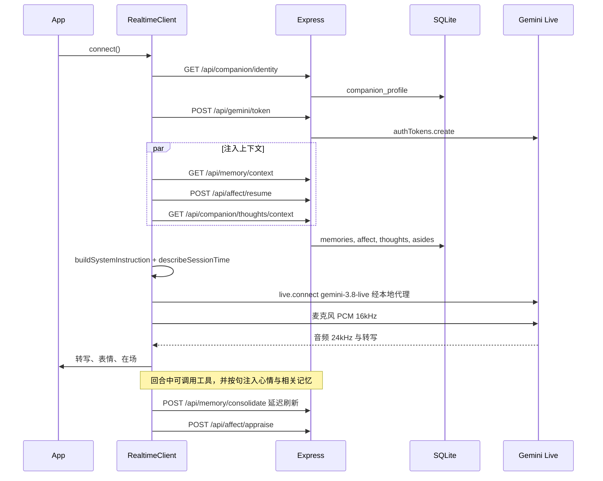

# 当前架构

初稿审计日期：2026-10-15。本文在对照 HEAD `3e9dd05` 后做了局部修订；未改动的段落仍以当时读到的调用链为准。进程有两个：Vite 开发服务器（5173）和 Express（3000）。生产构建只打包前端；服务端仍用 `tsx` 跑 `apps/server/src/index.ts`。

## 总览

浏览器不直连 Gemini 的公网 WebSocket。`RealtimeClient.connect` 把 `@google/genai` 的 `baseUrl` 设为 `window.location.origin + /api/gemini/live-proxy`。Vite 把 `/api`（含 WebSocket）转到 `http://localhost:3000`（`apps/web/vite.config.ts`）。服务端 `upgrade` 再用 `HttpsProxyAgent` 转到 `wss://generativelanguage.googleapis.com`。

天气、搜索、待办工具没有走这条相对路径，而是在 `RealtimeClient` 里请求 `http://localhost:3000`。

## 一次语音连线

`connect` 的实现在 `apps/web/src/realtime/RealtimeClient.ts` 的 `RealtimeClient.connect`。系统提示在连线时一次写进 `systemInstruction`，不会把上一场转写重放给模型。连线期间的补充走 `session.sendClientContent`：重逢提示 `cueReunion`、心情 `injectMood`、在场 `sendPresenceNote`、相关记忆（`/api/memory/relevant` 与 `/api/memory/between`）。

Gemini Live 自己保存这一场的多轮上下文。断开后这场上下文不在服务端。

## 谁调用谁

| 从 | 到 | 做什么 |
| --- | --- | --- |
| `App.tsx` | `RealtimeClient` | 呼叫、挂断、把到期提醒交给 `mentionDue` |
| `App.tsx` | `lastTalk.ts` | 本场草稿和上一场原文，只在 `localStorage` |
| `App.tsx` | HTTP | 身份、情绪 settle、提醒、留言；身份加载经 `identityLoad` 门闩防过期响应盖写（见 `0bdecb0`） |
| `MemoryPanel.tsx` | HTTP | 列表、`PATCH`、`DELETE` |
| `RealtimeClient` | `systemInstruction.ts` | 拼人格、记忆、心情、时间、远近、看法 |
| `RealtimeClient` | `presence.ts` | 旁边有人时是否开口 |
| `RealtimeClient` | `sessionTime.ts` | 本地时钟、时段、距上次连上多久 |
| `RealtimeClient` | `asides.ts` | 慢工具调用前播放固定接话 PCM |
| `index.ts` | `GoogleGenAI` | token、健康检查、情绪评定、记忆整理 |
| `index.ts` | `MemoryManager` | 上下文、回忆、记住、忘记、删除 |
| `MemoryManager` | `MemoryStore` | SQLite `memories` |
| `MemoryManager` | `meaning.ts` | Gemini embedding + 判定，挑相关记忆 |
| `index.ts` | `consolidate.ts` | 对话批次整理成档案、片段、看法、未决事项 |
| `index.ts` | `AffectStore` / `appraise.ts` | 情绪衰减、本地评定、必要时问模型 |
| `index.ts` → `identityRoutes.ts` | `Companion` | `GET /api/companion/identity`、`POST /api/companion/rename`（路由抽离见 `0bdecb0`） |
| `index.ts` | `ThoughtStore` | 看法、放不下的事、想问的问题 |
| `index.ts` | `AsideStore` + `aside.ts` | 人不在语音里时留一句；到期待办改口说或留下 |
| `index.ts` 15 秒定时器 | `tasks` 与 `decideAside` | 不是操作系统 cron，是进程内 `setInterval` |
| `App.tsx` 5 秒 / 15 秒 | 提醒与留言接口 | 页面开着才轮询。关页后数据留在 SQLite，下次打开再显示 |

模型提供商只有 Google Gemini（`@google/genai`）。搜索是 Tavily。天气是 Open-Meteo，不需要密钥。没有别的聊天模型接入。被注释的 `OPENAI_API_KEY` 没有调用点。

## 数据库

连接：`apps/server/src/db/index.ts` 在 import 时打开 `process.env.COMPANION_DB` 或 `companion.db`。Schema：`apps/server/src/db/schema.ts`。

| 表 | 内容 | 写入入口 |
| --- | --- | --- |
| `memories` | 档案、片段、判断、笔记、我们之间 | `MemoryStore` |
| `companion_profile` | 当前名和曾用名 JSON | `CompanionProfileStore` |
| `companion_affect` | 效价、唤醒、温暖、好奇、表情、第一次和上次见面 | `AffectStore` |
| `companion_thoughts` | `view` / `unresolved` / `question` | `ThoughtStore` |
| `companion_asides` | 当前留下的一句 | `AsideStore.leave` |
| `companion_aside_spoken` | 某件事的某一版已经说过 | `AsideStore` |
| `companion_voice` | 上次离开语音的时间 | `AsideStore.setAwayAt` |
| `tasks` | 待办与 `reminder_sent` | `index.ts` 任务路由和提醒轮询 |

没有会话表、用户表或设置表。

`memories.status` 为 `current` 或 `historical`。`forget` 把多值档案标成 historical，不删行。记忆面板的删除走 `DELETE /api/memory/:id`，物理删除。

## 定时与主动开口

服务端启动时立刻跑一次，之后每 15 秒（`index.ts` 的 `setInterval`）：

1. `checkTaskReminders`：到期且 `reminderSent = false` 的待办改为 `queued`。`speaking` 超过 45 秒退回 `queued`。
2. `checkAside`：语音会话数大于 0 时不留。否则 `decideAside` 从放不下的事、未问完的问题、约定、临近日子、到期待办里选一句，写入 `companion_asides`。

浏览器每 5 秒 `GET /api/tasks/reminders?voice=0|1`。人在语音里且 `mentionDue` 成功，则 `delivery` 为 `speak`，再 `POST /api/tasks/reminders/settle`。人不在，则服务端把句子留给留言。每 15 秒 `GET /api/companion/aside` 刷新「她留下的」。

另外，Gemini Live 配置了 `proactivity.proactiveAudio: true`。隔了至少三小时再连上时，`buildReunionOpening` 的 cue 经 `cueReunion` 发给模型，让她先开口。这不是后台推送。页面关掉、进程不在，没有推送通道。`Notification` 只在权限已经是 `granted` 时弹出，代码里没有 `requestPermission`。

## HTTP 面

绝大多数路由仍注册在 `apps/server/src/index.ts`。身份相关路由在后续修正 `0bdecb0` 中抽到 `apps/server/src/companion/identityRoutes.ts`，由 `registerCompanionIdentityRoutes(app, companion)` 挂到同一 Express 应用。`server.listen` 写在 `index.ts` 中部，其后仍有同步注册的路由；`listen` 的回调晚于这些注册，所以这些路由在开始接请求前已经挂上。

| 方法与路径 | 作用 |
| --- | --- |
| `GET /health` | 存活 |
| `GET /api/gemini/health` | 经代理打 Gemini，并查出口 IP |
| `POST /api/gemini/token` | 30 分钟、一次使用的 ephemeral token |
| WebSocket `/api/gemini/live-proxy/*` | 代理到 Gemini Live |
| `GET /api/weather` | Open-Meteo |
| `GET /api/search` | Tavily |
| `GET/POST /api/tasks`，`PATCH /api/tasks/:id/complete`，`DELETE /api/tasks/:id` | 待办 |
| `GET /api/tasks/reminders`，`POST /api/tasks/reminders/settle` | 到期提醒的说或留 |
| `GET /api/companion/identity` | 读名字、曾用名与只读人格（`identityRoutes.ts`） |
| `POST /api/companion/rename` | 改名并持久化到 `companion_profile`；非法名 400，存储失败 500（`identityRoutes.ts`） |
| `GET/POST /api/companion/thoughts`，`GET .../context`，`GET .../:id` | 看法与未决 |
| `POST /api/companion/session-view` | 本场看法，不直接落库 |
| `GET /api/companion/aside` | 当前留言 |
| `POST /api/affect/resume`、`settle`、`appraise` | 重逢情绪、衰减、按用户句更新 |
| `GET /api/memory`，`GET /context`，`GET /between`，`GET /relevant`，`GET /search` | 读与检索 |
| `POST /api/memory/consolidate` | 整理一场对话 |
| `POST /api/memory`，`POST /api/memory/remember`，`POST /api/memory/forget` | 写与撤销 |
| `PATCH/DELETE /api/memory/:id` | 面板编辑和删除 |

### 已删除的旧接口（审计时发现，非当前有效路径）

2026-10-15 审计时，`index.ts` 里曾有 `POST /api/memory/identity/name`：合法名字校验通过后不写库、不结束响应（会挂到客户端超时）。同文件的 `GET /api/memory/identity` 整段被注释。名字的产品入口一直是 `Companion` 与 `POST /api/companion/rename`。该空壳路由已在 `0bdecb0` 删除，不应再当作当前 API。

### 仍未消除的架构风险（审计发现，后续未声称已修好）

- 无账号与鉴权；`cors()` 默认放开。能打到 3000 端口即可读记忆、改名、取 Gemini token。
- 天气 / 搜索 / 待办在浏览器里写死 `http://localhost:3000`，与经 Vite 代理的相对 `/api` 并存。
- 会话原文只在浏览器 `localStorage`，不进 SQLite。
- Live 代理缓冲满 32 条时丢弃客户端消息且不回错；`voiceSessions` 只计本进程。
- 以上条目在对照 HEAD `3e9dd05` 的源码结构时仍可见；**未在本次文档修订中重新跑安全或负载验证**。

工具声明在 `sessionFunctionDeclarations`（`RealtimeClient.ts`）：`hold_view`、`rename_companion`、`remember_memory`、`forget_memory`、`recall_memory`、`get_weather`、`web_search`、`create_task`、`list_tasks`、`complete_task`、`delete_task`。模型发出 function call 后，由 `RealtimeClient` 再请求上面的 HTTP。
